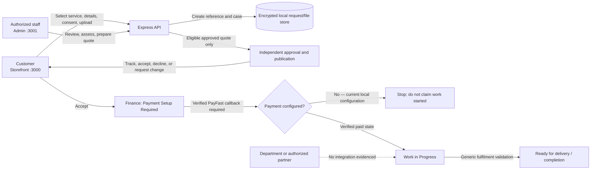

# WeQ4UServices Phase 1 Readiness Assessment

**Assessment date:** 18 November 2026  
**Purpose:** Readiness review before expanding the “Just Bought a Car” journey  
**Scope:** Read-only review of the current service registry, request/quote/workflow code, local payment configuration, architecture documents, functional test specification, service catalogue, and existing visual evidence. No application functionality was changed.

## 1. Readiness verdict

## **MOSTLY — for a controlled pre-payment demonstration only**

The platform can demonstrate much of the customer and staff workflow for a narrowly eligible service: request intake, file upload, request creation, staff queue visibility, document review, assessment/readiness gating, quote preparation, independent approval, publication, customer decision, and status tracking. It cannot demonstrate the requested *complete* Phase 1 journey through verified payment, service-specific fulfilment evidence, delivery, and closure. An accepted quote is deliberately routed to **Payment Setup Required**; the workflow blocks **Work in Progress** until payment is verified. Therefore the exact proposed demo can stop truthfully at the payment gate, but must not be presented as end-to-end fulfilment.

| Customer/admin step | Current capability | Readiness |
|---|---|---|
| Select a service and provide request details | Storefront catalogue and request flow | Supported generically; service definitions and variants are not all approved |
| Upload supporting documents and submit | File upload, request creation, and reference generation | Supported; upload acceptance does not prove document correctness or checklist matching |
| Request appears in staff workspace | Admin request queues and request detail | Supported |
| Review/reject documents and assess case | Staff review state, service assessment, readiness gate | Supported generically; many service checklists/rules remain draft or provisional |
| Prepare, independently approve, and publish quote | Versioned quote draft, preview, different-reviewer approval, publication | Supported only for registry-eligible cases with an active matching profile |
| Customer decides and tracks status | Tracking page, quote decisions, customer-facing status/history | Supported for eligible published quotes; outbound email is configuration-dependent |
| Record fulfilment milestones and close case | Generic workflow flags and status transitions | Partial; payment gate prevents work progression, and service-specific completion evidence/integrations are not demonstrated |

### 4D workflow assessment

| 4D stage | Assessment |
|---|---|
| **Discover** | **Mostly present.** Customers can select catalogue offerings, provide details, consent, and submit a request. The catalogue, service codes, variants, and approval states do not yet align across all planning documents and the live registry. |
| **Document** | **Partial.** Upload, staff verification/rejection, and missing-document requests exist. Requirements are not uniformly approved or service-specific, and uploads are not semantic proof of a correct document. The previous QA run also found that a corrupt PDF was accepted. |
| **Decide** | **Strongest stage, but narrowly gated.** Assessment/readiness, quote drafting, distinct-person approval, publication, customer decisions, and tracking exist. Current customer-quote eligibility is much narrower than the full catalogue. |
| **Deliver** | **Not demonstrated end to end.** Workflow states and generic validation flags exist, but payment is not configured in the local environment, work cannot start until a verified payment, and there is no demonstrated service-specific authority submission, appointment/certificate evidence, delivery proof, and closure. |

## 2. Recommended demo candidate

### **Driver’s Licence Renewal**

This is the best current candidate because its renewal variant is the only one explicitly configured in the current registry for customer quote issuance (`issueCustomerQuote: true`). It still has **provisional** service/variant and checklist status, and quote preparation also requires an active matching pricing profile and a completed assessment. Obtain business approval of the checklist, fees, wording, and conditions before presenting it as an approved offer.

**Do not use PrDP Application as the current end-to-end quote candidate.** The older Phase 1 master specification labels `PRDP-NEW` “Implemented,” and the historical quote-demo folder contains a PrDP quote screenshot. However, the current registry marks the PrDP service and application variant **draft**, does not enable customer quote issuance, and the quote gate rejects it. The old screenshot is synthetic, predates the current gate, and is not proof that a new PrDP quote can be issued now.

## 3. Current service-catalogue readiness

The API catalogue contains the nine service families in the assessment request, plus a separate “New vehicle owner help” entry. The code registry contains service variants, but current quote eligibility is not equivalent to catalogue visibility or an “active” pricing label.

| Catalogue family | Current quote/registry position |
|---|---|
| Driver’s Licences | Driver’s Licence Renewal is provisionally quote-enabled; other variants are not generally enabled |
| PrDPs | Draft; customer quote issuance blocked |
| Licence Disc Renewals | Draft registry variants; customer quote issuance blocked |
| Vehicle Registrations | Draft registry variants; customer quote issuance blocked |
| Change of Ownership | Draft registry variants; customer quote issuance blocked |
| Duplicate Documents | Draft registry variants; customer quote issuance blocked |
| Roadworthy Certificates | Draft registry variants; customer quote issuance blocked |
| Traffic Register | Draft registry variants; customer quote issuance blocked |
| Door-to-Door Courier | Draft registry variants; customer quote issuance blocked |
| New vehicle owner help (“Just Bought a Car”) | Appears as a catalogue entry, but it is not evidence that the onboarding family has a complete operational service definition and fulfilment path |

The API’s public pricing catalogue can show a service as active or “quote after review” while the service registry still blocks quote issuance. Treat registry approval, approved checklist/version, and active matching pricing profile as the authoritative quote gates; reconcile the catalogue labels before a formal demonstration.

## 4. Gap analysis

### End-to-end demonstration blockers

1. **PrDP quote gate:** PrDP Application is draft in the current registry and cannot produce a customer quote, despite the older master specification’s “Implemented” label.
2. **Narrow eligible scope:** Only the Driver’s Licence Renewal variant is configured for customer quotation; this is provisional, not broad catalogue readiness.
3. **No verified payment in the demo environment:** The PayFast integration code exists, but the current local configuration check reports it is not configured (sandbox mode is selected). The available tests use mocked credentials/callback validation; they do not prove a real sandbox transaction or settlement.
4. **Fulfilment is gated:** `Quote Accepted` routes to Finance / **Payment Setup Required**. `Work in Progress` requires `paymentStatus === 'paid'`; ready-for-delivery and completion additionally require fulfilment and completion confirmations.
5. **Generic rather than service-specific milestones:** Admin can record generic checks/status history, but the review found no demonstrated PrDP booking/application submission, authority reference, appointment evidence, permit issuance, delivery proof, or service-specific closure evidence.
6. **No authoritative external workflow:** The DFD describes government/authorized-partner interfaces as future flows. No approved Department of Transport integration or authority outcome is evidenced.

### Payment-readiness blockers

- Configure and validate the merchant account, credentials, public HTTPS notification endpoint, allowed callback IPs, sandbox and then live settings.
- Run end-to-end sandbox payment cases including success, cancellation, decline, duplicate/delayed callback, amount mismatch, and reconciliation. The existing unit tests do not substitute for provider transactions.
- Define and evidence merchant-of-record, fee and statutory-charge treatment, receipts, refunds, disputes, settlement and bank reconciliation.
- Preserve the current gate: customer acceptance is not payment confirmation and must not authorize fulfilment.

### Production-readiness blockers

- The DFD and 4D documents are planning drafts. Their proposed managed PostgreSQL/private object storage foundation is not applied; the current prototype uses encrypted local request/file storage.
- Approve and version service definitions, checklists, pricing, eligibility rules, exception handling, customer promises, retention, privacy, and operational owners for each catalogue variant.
- Complete security/privacy, production identity and authorization, backup/restore, key management, monitoring, notification-failure handling, and operational support reviews.
- Fix document-integrity validation: the recorded library run accepted a corrupt PDF. Manual staff rejection is not equivalent to rejecting an invalid file at intake.
- Reconcile the different scope/counts/service codes in the catalogue, registry, DFD/4D drafts, and Phase 1 specification.

## 5. Evidence quality and visual proof

The repository does **not** contain a signed, completed Phase 1 Functional Validation Report. The available [Phase 1 Functional Testing Master Spec](../handover/WeQ4U_Phase1_Functional_Testing_Master_Spec.md) is a test plan: its consolidated Pass/Fail fields are blank and its sign-off fields are empty. Its service labels also conflict with the current registry. The [DFD/workflow document](../data/dfd-and-workflows.md) and [4D architecture](../architecture/enterprise-4d-design.md) explicitly describe target/planning designs, not a verified as-built production architecture.

The closest existing UI evidence is the [historical visual quote-demo report](./E2E-Visual-Quote-Demo-2026-11-13.md). Its screenshots can demonstrate individual synthetic screens, but **not** a fresh, complete PrDP journey:

- [PrDP quote screen](./E2E-Visual-Quote-Demo-2026-11-13/03-PrDP-Quote.png) — historical synthetic quote, not issuable under the current PrDP gate.
- [Staff Roadworthy quote screen](./E2E-Visual-Quote-Demo-2026-11-13/05-Staff-Roadworthy-Quote.png) and [staff queue](./E2E-Visual-Quote-Demo-2026-11-13/09-Staff-3001-Work-Queue.png) — synthetic staff UI evidence.
- [Accepted quote customer screen](./E2E-Visual-Quote-Demo-2026-11-13/06-Learner-Licence-Accepted.png) and [staff result](./E2E-Visual-Quote-Demo-2026-11-13/07-Staff-Learner-Accepted.png) — one historical synthetic acceptance routed to payment setup, not evidence of payment or fulfilment.

The attached “Just Bought a Car” and contact/request images show storefront screens only. None of these visuals proves that documents were verified, a PrDP quote was currently approved, payment was received, or a government service was fulfilled. They are 2D screenshots, not 3D renderings; for the Department’s technical review, annotated UI captures plus sequence/DFD diagrams and correlated test evidence are more probative than a 3D mock-up.

### Current as-is flow and stop point

In the current local demo setup, ports `3000` and `3001` can be routed to the isolated synthetic API on `4100`; the normal API is on `4000`. A screenshot from the isolated quote demo must be labelled synthetic and must not be confused with a production or live Department integration.

## 6. Strategic recommendation

### **Option A — complete and validate existing service journeys and payment/fulfilment gates before expanding “Just Bought a Car.”**

The 4D sequence depends on a proven service engine: approved scope and discovery (**Discover**), verified service-specific requirements (**Document**), controlled assessment/pricing/approval/customer decision (**Decide**), and payment-authorized work with evidence and closure (**Deliver**). Expanding the onboarding experience before those gates are validated would increase catalogue and exception complexity without proving that the existing engine can complete a case.

For Phase 1.5, demonstrate Driver’s Licence Renewal with synthetic data only and stop at **Payment Setup Required** if payment remains unconfigured. To claim full end-to-end readiness, first approve the service/checklist/pricing, complete a verified sandbox payment, and capture real workflow evidence for fulfilment and handover. Reconsider PrDP only after its current registry, quote profile, and service rules are approved and enabled.

## Recommended evidence gate before stakeholder presentation

1. Obtain owner approval for one service’s versioned checklist, pricing, eligibility, exclusions, and customer wording.
2. Use a fresh synthetic request; capture request reference and correlated timestamps.
3. Capture customer submission/upload and Admin receipt; show each document’s review decision and assessment readiness.
4. Capture quote draft, internal preview, independent approver, publication, and customer tracking view.
5. Record the customer decision and demonstrate the exact resulting staff/customer statuses.
6. If payment is not configured, stop at Payment Setup Required. Do not set a paid flag manually or show fulfilment as complete.
7. After sandbox payment validation, separately capture payment callback verification, work start, service-specific milestone evidence, customer handover, and closure.
8. Fill every Phase 1 test-matrix Pass/Fail row, attach evidence to each result, and obtain founder/service-owner sign-off.

**Validation note:** The workspace’s `apps/api/test/testDataLibrary.test.js` currently fails `node --check` because its contents are null bytes. The earlier saved test report/CSV are historical outputs; restore the test source and rerun the applicable suite before claiming that automated evidence is reproducible.
