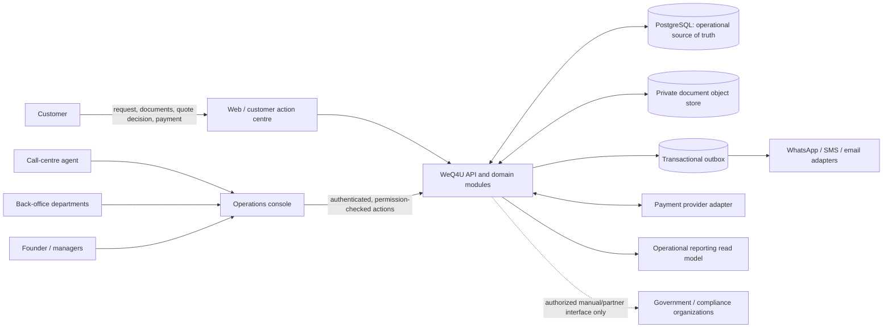
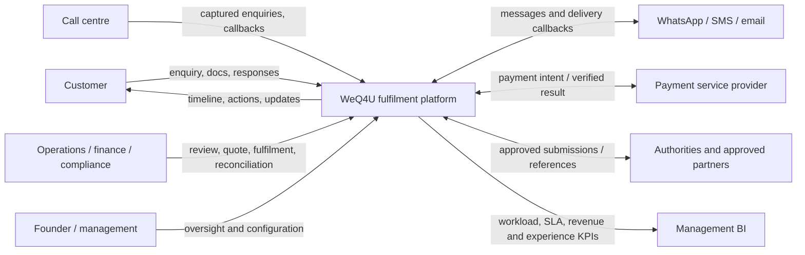
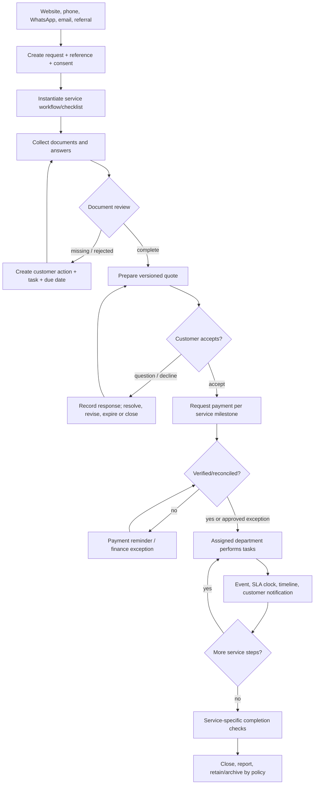
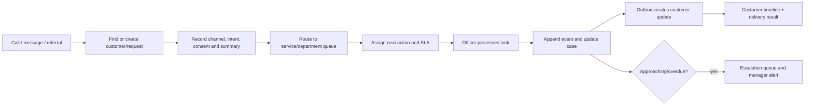
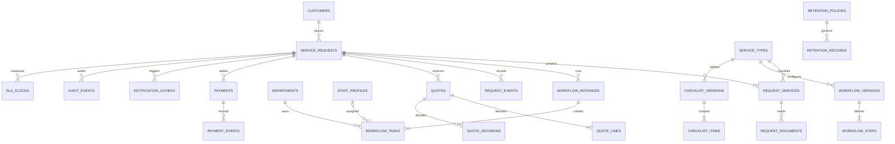

# WeQ4U Digital Service Fulfilment Platform

**Status:** Target architecture and product blueprint, derived from the authoritative Business Process Requirements PDF. It is a design baseline, not a claim that integrations or production controls are already deployed.

**Authority:** The 11-page Business Process Requirements PDF supplied for this task. Where this blueprint makes an engineering recommendation beyond the document, it is labelled as a design choice. Regulatory periods, provider contracts, fees, and service-specific operational rules require validation before activation.

## 0. Application boundary: customer site and staff console

`http://localhost:3000` is the customer-facing storefront and customer self-service experience. `http://localhost:3001` is the single staff-facing **Operations & Admin Console**. All call-centre, back-office, finance, compliance, supervisor, management dashboard, and technical administration screens belong inside the 3001 application. They are modules in one role-aware console, not separate staff sites or ports. The API is a service boundary and is not a staff UI.

On 3001, navigation and record access are filtered by server-enforced roles and permissions. A staff member sees only the workspaces and actions granted to them; system administration does not imply routine access to sensitive customer documents. The management cockpit is the default landing page for founder/management roles; officers land in their assigned queue; call-centre agents land in the enquiry/customer-contact workspace. This is a target product boundary and does not imply those modules already exist in the current admin app.

**Startup operating mode:** the current team is founder-led, not department-staffed. The founder and system administrator can work the common queues and manage approved pricing profiles. Department names remain routing/classification metadata; specialist support, operations and finance roles can be introduced later with narrower permissions. Payment acceptance, reconciliation, automated reminders, WhatsApp/SMS, contact-detail self-service and customer downloads remain gated or planned until their business rules and integrations are approved.

## 1. Product goal and confirmed requirements

WeQ4U is to grow from a founder-operated manual service into a digital fulfilment platform that coordinates customers, call-centre staff, back-office departments, finance, management, and approved external providers. The reusable platform owns a common case lifecycle; each service supplies its own intake, checklist, workflow steps, completion evidence, timing rules, and messages.

The authoritative requirements establish:

- Enquiry and intake can begin through the website, calls, WhatsApp, email, or referrals.
- The target lifecycle is enquiry/request → document collection and verification → quote → customer approval and payment → fulfilment → completion and closure. The PDF describes payment before work proceeds and asks for service-specific completion rules.
- Customers need a self-service action centre to upload missing documents, approve quotes, pay, respond to questions, and track progress.
- Tracking exposes completed steps, current and next step, remaining steps, estimated completion, days remaining, and SLA progress. Material events are timestamped.
- Notifications are event-driven and support WhatsApp, SMS, and email. The initial events include request received, missing/approved documents, quote generated, payment required, processing started, and completion.
- Call-centre and back-office work must use shared, role-scoped queues, assignments, escalations, and customer history. Departments can grow without creating separate service systems.
- Named system administrator, founder/managing director, back-office supervisor, and back-office officer roles are required. Every material action on requests, documents, quotes, payments, and role changes is attributable in an audit trail.
- Management needs intake and completion, backlog bottlenecks, department/user workload, outstanding tasks, SLA breaches, outstanding quotes/payments, payment delays, and revenue by service.
- Retention must be configurable. Records need active, archived, deleted, and legal-hold handling; every archive/purge action must be audited. The PDF's example of 0–2 active and 2–5 archived years is an MVP proposal to validate, not an approved legal schedule.
- The product principle is that a customer should not need to call just to learn request status.

The earlier service-specific working notes include a learner-licence sequence where an issue fee may arise after a pass. Reconcile that case with the PDF's upfront-payment default by modelling service-specific payment milestones and clearly separating authority charges from WeQ4U fees. Do not silently force one payment schedule onto every service.

## 2. Platform shape (4D)

| Dimension | Target |
|---|---|
| **Business** | Customer self-service; call-centre enquiry capture; operations and service departments; document review; quote/approval; payment/reconciliation; fulfilment and delivery; management intelligence; governance. |
| **Data** | Customer/contact snapshots; requests and service instances; versioned intake/checklists/workflows; private document metadata; tasks/assignments; quote versions and categorized lines; payment ledger and refunds; event timeline; SLA clocks; notification outbox; audit; retention and archive records. |
| **Application** | Customer storefront/action centre on :3000; one staff Operations & Admin Console on :3001; API/domain services, workflow and task engine, document service, quote/payment services, communication adapters, reporting read model. Start as a modular monolith; preserve replaceable adapters. |
| **Technology** | React/Vite clients; Express API; managed PostgreSQL; private object storage; staff identity provider; background job worker/outbox; monitored email/SMS/WhatsApp and payment adapters. Current encrypted local JSON is development-only. |

### Context and trust boundaries

Customer browsers never receive privileged database or storage credentials. Provider webhooks are authenticated, idempotent inputs; a message or payment is not considered delivered/settled solely because a request was sent.

## 3. DFDs

### Level 0: platform context

### Level 1: request-to-fulfilment flow

### Level 1: call-centre and operations flow

## 4. Domain model and ERD

### PostgreSQL logical design

Use UUID primary keys, UTC `timestamptz`, `numeric`/integer minor units for ZAR (never floating point), foreign keys, check constraints, and append-only event tables. Use JSONB only for versioned service-specific answers and safe provider metadata; normalize operationally queried state.

| Area | Core tables and important rules |
|---|---|
| Identity and scope | `staff_profiles`, `departments`, `roles`, `permissions`, `role_permissions`, `staff_user_roles`, optional `staff_department_memberships`; provider identity ID is external, not password data. |
| Service configuration | `service_types`, `intake_schema_versions`, `checklist_versions/items`, `workflow_versions/steps/transitions`, `completion_rules`, `sla_policies`; effective-dated and versioned, changes do not rewrite active cases. |
| Customer/request | `customers` as deduplicated contact identity where appropriate; `service_requests` with public reference, source, contact snapshot, consent and coarse current summary; `request_services` per selected service with intake JSON/schema version. New customer references are cryptographically random and act as the single bearer credential for customer tracking. Never use sequential references as authorization; rate-limit lookups and keep contact details and documents out of reference-only public previews. |
| Documents | `request_documents` metadata only: opaque object key, checksum, media type/size, classification, service/checklist link, scan/review state, uploader, timestamps, retention classification. `document_reviews` records accept/reject/reason; `document_access_events` logs sensitive reads/downloads. Bytes remain in a private bucket. |
| Workflow/operations | `workflow_instances`, `workflow_tasks`, `task_events`, `request_events`, `request_assignments`; task ownership can be department queue then named user. Tasks have priority, due time, pause reason, retry/escalation state. Events are append-only; current state is a projection. |
| Quotes | `quotes` version and status; `quote_lines` category (`handling`, `authority`, `third_party`, `courier`, `other`), description, quantity, unit/line amounts, tax treatment, payee/pass-through flag; `quote_decisions` actor/channel/time. Issued quote versions are immutable. |
| Payments | `payment_orders` references quote/milestone and amount due; `payment_transactions` provider reference, amount/currency, state and idempotency key; `payment_events`; `refunds`; reconciliation batches/entries. Never store PAN/CVV or treat uploaded proof as provider confirmation. Maintain ledger-style entries so revenue and pass-through funds can be reported separately. |
| Communication | `notification_preferences`, `notification_templates` versioned by locale/channel/event, transactional `notification_outbox`, `notification_attempts`, inbound `conversations/messages` with channel/provider ID and request link. Keep sensitive docs out of messages; use authenticated links. |
| SLA/BI | `sla_clocks` per request/task with policy snapshot, start/due/paused/resumed/stopped times and breach state; `business_calendars`; materialized/reporting views for intake, completion, ageing, workload, conversion, SLA, collections and revenue. Store policy version so historic KPI results stay interpretable. |
| Governance | `consent_events`, append-only `audit_events`, `data_classifications`, `retention_policies`, `retention_records`, `archive_records`, `purge_audit_logs`, `legal_holds`. Retention rules are effective-dated and deletion jobs are reviewable/idempotent. |

Reference allocation occurs transactionally. Enforce idempotency on customer submission and provider callbacks. Deletion is restricted for financial/audit evidence; apply anonymization or controlled purge only under an approved retention/legal-hold policy.

## 5. Workflow engine and service lifecycle

Implement a configuration-driven workflow as a versioned state machine plus a task engine, not arbitrary business logic encoded in a generic workflow language. A `workflow_instance` snapshots its workflow version. A transition command validates role, source state, required evidence, payment gate and completion conditions in one database transaction, writes an event, advances projection, closes/creates tasks, updates SLA clocks, and writes an outbox notification.

### Common case states

`Enquiry` → `Received` → `DocumentsRequired` / `DocumentsUnderReview` → `ReadyToQuote` → `QuoteAwaitingCustomer` → `AwaitingPayment` → `ReadyForWork` → service-specific `InProgress` steps → `ReadyForReturn` → `Completed` → `Closed`.

Terminal/exception paths: `Declined`, `Cancelled`, `QuoteExpired`, `OnHold` (reason and review date required), `ExternalDelay`, `ActionRequired`, and `Rework`. Each service config selects only applicable states and completion rules. Payment is a service-configured gate; the PDF default is customer approval and payment before work begins. A permitted later milestone is an explicit rule with amount, trigger, and authority, not an informal bypass.

Example driver licence completion rule: verified payment → booking confirmed → appointment given to customer → evidence/confirmation recorded → completion. Other service completion criteria are separately configured and approved. A task cannot be marked done without its required outcome/evidence fields.

### Automation and escalation

1. Intake creates reference, service workflow, checklist, initial triage task, event and acknowledgement atomically.
2. Missing/rejected document creates a precise customer action, owner task, due date and notification; reminders are scheduled with deduplication and stop when action is completed.
3. Complete review enables quote preparation. Quote approval policy controls who can issue it; customer acceptance is captured through a signed action link or verified channel and recorded.
4. Payment order follows the approved quote/milestone. Signed provider callback or finance reconciliation advances payment; failures produce visible customer action and finance task.
5. Payment gate releases fulfilment tasks. Queue routing uses service, department, region/coverage and capacity; unassigned or ageing tasks escalate to supervisor.
6. Every material state/task/document/quote/payment change appends an event, updates the customer timeline when suitable, refreshes the KPI projection and creates only the permitted notifications.
7. A scheduled SLA worker evaluates due clocks, business calendars, pauses and escalation tiers. It raises tasks/alerts and does not silently alter target dates.
8. Completion validator checks service-specific required steps, document return/delivery evidence, balance, customer message and open tasks before closing.

Retries use idempotency keys and exponential backoff; dead-letter items become visible in an integration support queue. Manual fallback is explicit and auditable.

## 6. Customer journey and communications

| Journey | Customer sees/does | Platform response |
|---|---|---|
| Discover/enquire | Choose service, answer guided questions; call-centre agent can enter the same intake | Plain-language scope, coverage and next steps; create/update lead without duplicate case |
| Request received | Reference and privacy/consent information | Immediate acknowledgement; secure tracking access; estimate labelled preliminary |
| Documents | Service-specific checklist with required/optional, why needed, accepted formats and secure upload | Per-file receipt, scan/review status, clear missing/rejected reason and resubmission action |
| Quote | Itemized fees, validity, inclusions/exclusions, estimated timeline and payment milestone | Versioned quote, accept/decline/ask question actions, reminders before expiry |
| Payment | Amount, safe provider checkout, receipt | Payment state and receipt; only verified settlement releases gated work |
| Fulfilment | Timeline of completed/current/next/remaining steps, estimated completion, SLA progress, action required | Event update at each material transition; explain external delays and next update time |
| Completion | Outcome, collection/delivery instructions, final statement, support/feedback path | Completion confirmation, closeout event, satisfaction prompt, retention policy starts |

### Notification framework

Events: request received; document uploaded/verified/missing/rejected; quote issued/revised/expiring/accepted/declined; payment required/confirmed/failed/refunded; processing started; appointment booked/changed; external delay; action required; SLA update where customer-visible; ready/delivery dispatched/delivered; completed/closed.

Preference and consent rules are channel-specific. WhatsApp must use approved business messaging, opt-in and approved templates where required; SMS/email remain fallbacks by preference and deliverability. Each outbox item has a safe payload, idempotency key, template version, attempts, provider status and correlation ID. Never include identity document contents, full ID values, card details, or publicly accessible document URLs. Failed delivery creates a retry and an agent follow-up task; it must not block or lose case processing.

WhatsApp integration is an adapter: outbound approved templates and authenticated status/actions; inbound webhook signature verification, provider message deduplication, consent/STOP handling, case matching by protected reference/verified contact, and handoff to a human queue. A `TRACK <reference>` reply can return the same minimal current/next/action/estimate summary as the portal after appropriate verification. Store only needed conversation metadata/content under the approved retention policy.

## 7. RBAC and audit

Use individual staff identities, least privilege, department/data scope, MFA for privileged roles, and API-side authorization on every operation. UI hiding is not authorization. Separate quote issue/approval, payment reconciliation/refund, role administration, document access and audit review where staffing allows. Break-glass access requires reason, time limit and enhanced audit.

| Role | Default permissions |
|---|---|
| System administrator | Identity, security, configuration, service/workflow setup, platform health; operational customer data only when separately granted and audited. |
| Founder / managing director | Cross-business operations, revenue, approvals, service management and management reports; no routine secret or credential access. |
| Back-office supervisor | Department queues, assignments, escalations, approvals within delegated limits, performance monitoring. |
| Back-office officer | Assigned/team-scoped tasks, relevant request data, document verification and customer communication; no payment/refund, role or policy administration by default. |
| Call-centre agent | Enquiry/contact history, request creation, customer actions and approved status communication; sensitive document bytes and financial mutation denied by default. |
| Finance officer | Quotes/financial line items, payment reconciliation, receipts/refunds within limits; document access denied by default. |
| Auditor | Read-only approved records and audit/report data; document contents denied unless explicitly scoped. |
| Customer | Own case via authenticated session or strong one-time link; own documents, quote decisions, payment action and timeline only. |

Audit records actor, actor type, action, object, request, timestamp, correlation ID, reason and safe before/after summary. Log document view/download, export, permission and retention actions. Never log secret, full document contents, credentials or payment card data. Protect audit storage from ordinary update/delete.

## 8. SLA, dashboard and BI specification

SLA policies are configurable by service, task type, priority, coverage and business calendar. Track acknowledgement, document review, quote turnaround, customer action wait, payment wait, internal fulfilment, external authority wait, delivery and end-to-end elapsed time separately. Pause clocks only for named states with start/end reason. Report gross elapsed and controllable WeQ4U time separately; external/customer pauses remain visible. Targets and calendars are not invented: configure after operating data and founder approval.

### Management cockpit (PDF's five questions)

| Question | KPIs/visuals | Filters and drill-through |
|---|---|---|
| How much work came in today? | New requests, calls, WhatsApps, emails; trend and source mix | Date, service, source, area; open request/inbound list |
| How much was completed today? | Completed requests/services, reconciled receipts and handling revenue | Date, service, department; closed case and ledger entries |
| Where is work stuck? | Pending documents/quotes/payments, overdue cases, SLA breaches, age bands and stage conversion | Service, stage, owner; blocked case and next action |
| Who is overloaded? | Department/user open workload, outstanding tasks, backlog age, capacity and due soon | Department, person, task type; scoped task queue |
| How much revenue is at risk? | Outstanding quote value, unpaid accepted quotes, payment delays, refunds, collected handling revenue and revenue by service | Period, service, quote/payment state; quote and reconciled payment |

Additional customer experience: median/90th percentile time to first response and completion, notification delivery, action completion latency, repeat contacts/status calls, complaints and satisfaction. Define formulas, time zone, cohort, cancellations, refunds and pass-through exclusion in a data dictionary. Dashboard tiles drill to permission-filtered records. Separate operational near-real-time views from reconciled finance reporting; show data freshness and no-data state.

## 9. Document, payment, and retention controls

Documents are private objects, malware-scanned/quarantined before staff review, type/size/signature validated, encrypted in transit/at rest, accessed through short-lived authorized links, versioned on replacement, and associated with checklist/version and review decision. Keep hashes and audit metadata; do not expose original filenames in public paths. Define export, backup, deletion and restore processes.

Payment provider handles card credentials; WeQ4U stores only provider token/reference, status, currency, amounts, timestamps and reconciliation evidence. Verify signed callbacks and idempotently reconcile late/duplicate/out-of-order events. Quotes distinguish handling income from government/statutory, third-party and courier pass-through charges. Support partial/multiple payments only if the approved business process needs them. Refunds and write-offs require reason and separate permission.

Retention is policy-driven by record class (request/contact, document, quote, payment/audit, communication), service, purpose, effective date and trigger. Lifecycle: active → archived → deletion review → deleted, or legal hold. The PDF's sample active/archive ranges are placeholders pending applicable legal, tax, privacy, contractual and department requirements. Deletion job previews candidates, excludes legal holds, requires configured approval where appropriate, removes object and metadata safely, records a purge audit tombstone, and can be retried idempotently. Do not encode a duration until the schedule is approved.

## 10. Delivery architecture and rollout

Keep the existing React/Vite and Express codebase as a modular monolith initially. Add domain modules and repository interfaces; PostgreSQL is source of truth, private object storage holds files, a background worker drains a transactional outbox, and reporting uses controlled views. Separate development/staging/production, migrations, secrets, backups and access policies. Do not expose provider secrets in Vite/browser code.

1. **Product foundation:** agree canonical case/service language, service catalogue and service-specific intake/workflow/checklists/completion criteria; preserve the requirements already established here.
2. **Core operations:** PostgreSQL migration, staff identity/RBAC, task queues, assignments, event timeline, document verification, quote versions, configurable payment gate and customer tracking.
3. **Automation:** transactional outbox, email/SMS/WhatsApp adapters, reminders, SLA calendars/escalation, retry/dead-letter support.
4. **Commercial controls:** payment provider, reconciliation, refund/receipts, finance reporting, after merchant and accounting rules exist.
5. **Management BI:** KPI data dictionary, operational cockpit, drilldowns, reconciled revenue and customer satisfaction.
6. **Scale:** capacity routing, additional regions/services, approved partner/government interfaces, analytics warehouse only when reporting volume warrants it.

Production cutover requires reviewed migrations and rollback, staff accounts/MFA, access and upload controls, notification/payment provider setup, backup/restore rehearsal, retention schedule, incident procedures, support playbooks and a controlled migration decision for prototype data. Government automation is not presumed: require an official interface, written authorization and sandbox; retain an auditable manual step until then.

## 11. Implementation boundary and acceptance outcomes

**Present prototype:** public request capture with service questions/documents, private reference tracking, customer document follow-up, a local encrypted request store, and an admin console with request operations, an executive dashboard, CSV export, and role-specific API permissions. Staff access currently uses environment-configured bearer tokens rather than individual identity accounts. PostgreSQL persistence, individual identity/MFA, full workflow/task engine, payment system, automated messaging, configured SLA engine, financial reconciliation, and production BI are still outstanding. See `docs/workflows/dashboard-and-staff-access.md` for the dashboard's data boundaries and remaining requirements.

**First useful implementation slice:** persist the current intake in PostgreSQL; create service workflow/task/event records; expose a secure customer timeline/action link; add individual staff identity and queue/assignment permissions; implement document review and versioned quote; deliver reliable email updates through an outbox; report queue age and stage counts. Keep payments manual/reconciled until provider and finance rules are approved, while representing payment orders and gates in the model. Add WhatsApp/SMS adapters once business accounts, consent, templates and provider webhooks are ready.

Acceptance outcomes:

- Every request has an owner/queue, next action, visible stage, dated timeline and service-specific completion criteria.
- Customer can see progress and complete requested actions without a status call; failed notification is observable and recoverable.
- Every workflow transition is validated, attributable, timestamped and audited.
- Documents remain private; authorized staff only can review/download and access is logged.
- Quotes preserve versions and distinguish handling fees from pass-through charges; payment state requires verifiable reconciliation.
- Supervisors can see stuck work, overdue tasks, SLA risk, workload and escalations; management can drill from KPIs to permitted underlying records.
- Retention and purge are configurable, legal holds block deletion, and purge/archiving is auditable.
- New service workflows are configurable/versioned without duplicating the customer, task, document, quote, notification and reporting platform.
