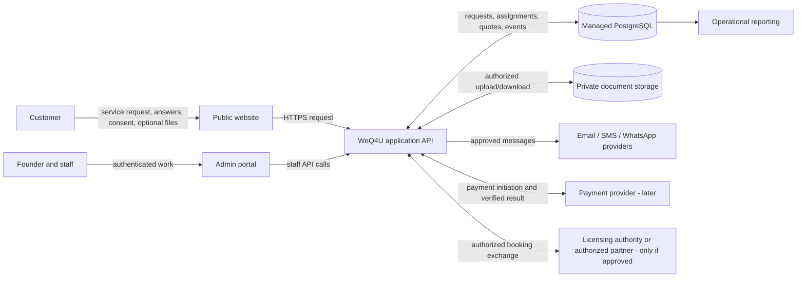

# WeQ4UServices 4D Enterprise Architecture

**Status:** Planning proposal for founder review. This is a target design, not a statement that every module exists today.

## Scope boundary

The target platform supports customer self-service and a single staff-facing Operations & Admin Console at `http://localhost:3001`. The customer website/action centre remains at `http://localhost:3000`. All back-office, call-centre, finance, compliance, management dashboard and technical administration workspaces are modules within the 3001 application and are shown by role. The first production database must model the full request, document, quote, payment gate/reconciliation, staff task, event, notification, SLA and audit lifecycle. External payment-provider automation, WhatsApp/SMS delivery and government interfaces can be integrated in phases; the underlying workflow must still represent these business processes from the beginning.

## The four dimensions

| Dimension | Initial production scope | Later capabilities |
|---|---|---|
| Channels | Customer website/action centre at :3000; one role-aware staff console at :3001; calls, WhatsApp and email captured in the same case record | Mobile app, USSD, additional approved communication channels |
| Business services | The eight current catalogue services: driver's licences, PrDPs, disc renewals, vehicle registration, ownership change, duplicate documents, roadworthy coordination, courier | Additional authority services only after founder approval and operational validation |
| Process and workflow | Request intake, service-specific clarification, document collection/review, quote versions, customer approval, payment gates, assignment, status history, fulfilment, delivery, SLA, audit | More advanced routing, automated refund flows and quality controls |
| Data and technology | React/Vite web apps, Express API, managed PostgreSQL, private object storage, staff identity, server-side access controls, transactional outbox and backups | Analytics warehouse, provider-specific payment/messaging adapters, authorized government connector, multi-province/multi-tenant support |

## Context diagram

Payment, notification automation and authority integration are not assumed active. The API remains the control point; browser applications must not receive database service credentials or private storage keys.

## Main components and trust boundaries

1. **Customer channel:** public catalogue and request form. Customer input is untrusted. The initial flow remains accountless; customers use a reference for limited status lookup.
2. **Staff channel:** private admin portal. Staff authenticate individually. Permissions are checked by the API for every privileged operation.
3. **Application API:** owns validation, reference generation, state transitions, quote rules, authorization, audit events, notification queueing and integration adapters.
4. **Operational data:** PostgreSQL stores structured data and immutable workflow events. Private object storage holds uploaded and returned documents. Public URLs and document contents do not belong in the database.
5. **Integration boundary:** providers are replaceable adapters. A provider response is verified and recorded before it changes a request, quote or payment state.
6. **Reporting:** operational reports read governed records and aggregate views. Financial reporting uses quote/payment records and must distinguish collected authority charges from WeQ4U handling revenue.

## Deployment and security principles

- Keep development, staging and production data stores separate.
- Use checked-in SQL migrations, review them, and rehearse rollback and restore before production cutover.
- Use a private storage bucket, opaque object keys, size/type/signature validation and malware scanning before staff access.
- Default-deny anonymous access to request, quote, staff and audit data. Keep privileged credentials server-side.
- Record consent version/time, staff actor and status/quote changes. Keep sensitive values and document contents out of logs.
- Establish retention, deletion/export, breach response, backup and key-rotation procedures with the business before real customer records are moved.
- Do not treat the local encrypted JSON and local file store as production infrastructure.

## Phased delivery

1. **Validate operations:** founder walkthrough for each service, exceptions, quote rules, roles and retention.
2. **Approve core model:** agree request lifecycle, required data, checklist versioning, quote line categories and reporting definitions.
3. **Database foundation:** provision isolated Supabase projects, apply reviewed core migrations, seed approved services, configure Auth/RLS and private storage.
4. **API cutover:** add repository layer, migrate reviewed prototype records only if they contain legitimate business data, reconcile references/files and preserve rollback.
5. **Admin operations:** role-aware work queues, assignments, document review, quote versions, status history and audit views.
6. **Reporting:** define KPI formulas and build dashboards from reconciled data.
7. **Commercial integrations:** add notification and payment adapters after account onboarding and process approval.
8. **Scale integrations:** assess province/department expansion and government interfaces only with written authority, official documentation and a sandbox.

## Current prototype versus target

The current code has a public request flow, document upload, reference tracking, one token-protected staff desk, status and single quote amount updates, CSV export, and encrypted local file persistence. It does not have PostgreSQL, staff accounts/roles, quote versions/acceptance, payment processing, assignment queues, immutable audit history, SLA rules or a reporting layer. Those are design and implementation work, not existing capabilities.
