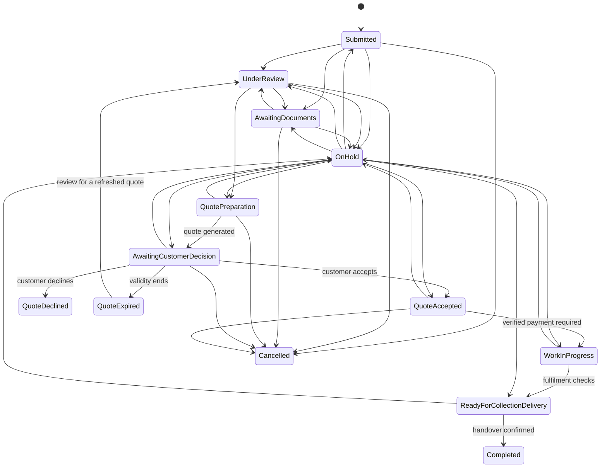

# Operations Workflow and Reporting Design

**Status:** Target workflow baseline aligned to the supplied Business Process Requirements PDF. Operational values (service-specific rules, SLA targets, prices, payment milestones and retention periods) remain configurable inputs to validate before production activation. See the [platform blueprint](../architecture/digital-service-fulfilment-platform.md).

## Application boundary

- `http://localhost:3000`: public catalogue, request intake, customer action centre and self-service tracking.
- `http://localhost:3001`: the single staff-facing Operations & Admin Console for call-centre, back-office departments, finance, compliance, supervisors, management dashboard and technical administration. These are role-aware modules inside one application, not separate staff sites.
- The API, database and background workers are service components and do not create additional staff-facing dashboards. Authorization is enforced server-side for each data/action request.

## Canonical request lifecycle

The API currently enforces this canonical lifecycle, routes each stage to a department and named queue, clears the previous assignee on a stage change, and exposes only valid next stages to staff. During the founder-led startup phase, a stage change made by the founder or system administrator automatically assigns the new work to that actor; future specialist roles can use team queues and explicit assignments. Departments are routing labels, not a staffing requirement. Legacy records are normalized when read. Customer-facing labels and timeline messages are separate from internal stage names.

Quotes are generated from the active, approved pricing profile only after staff confirm the service scope and documents, provide customer-facing notes, and set a future validity date. Finance, the founder and the system administrator can manage pricing profiles; future Finance staff can take over that responsibility without changing the pricing engine. A quote is not revenue. Generation creates a versioned quote snapshot and publishes it immediately to the customer's private tracking portal, moving the case to **Awaiting Customer Decision** without requiring email, SMS or WhatsApp. Email is an optional additional notification only. A customer can accept or decline a specific quote version once; the portal records view activity, decision timestamp, version, and decline reason. Quote decisions are reporting data, not payment confirmation.

Payment collection and verification are not implemented. An accepted quote routes to Finance's **Payment Setup Required** queue; it cannot progress to **Work in Progress** without a future, genuinely verified payment state. Do not mark funds paid manually, create an invoice/EFT request, or begin fulfilment based on quote acceptance alone. Service-specific payment milestones, external delays/rejections and exceptions require approved configuration and must never bypass the gate implicitly.

### Customer action model

The request lifecycle stays canonical; customer actions are tracked separately so clarification, appointment and delivery requests do not create extra workflow stages. Staff can create **information/clarification**, **appointment confirmation**, and **collection/delivery confirmation** tasks with a clear title, instruction and optional due date. Customers respond from Track Request; the response and timestamps appear in the staff workspace and activity timeline. Staff then review the response and mark the task complete. Requested documents are represented as customer tasks as well as being available in the secure upload control; an upload returns the case to review. Customers can also send labelled supporting documents from their private tracking view at any open stage; the request's stage does not change, and the upload is recorded in its timeline for staff review.

The Admin's **Waiting on Customer** queue aggregates open customer actions, document requests and quote decisions. A customer response leaves that queue and returns to the request's operational stage for staff follow-up. Task email notifications are attempted when email and the Resend integration are configured; otherwise the Admin explicitly prompts staff to contact the customer. Automated reminders, SMS/WhatsApp delivery, contact-detail self-service, payment, and customer result downloads are not implemented yet and must not be presented as live features.

### Staff processing sequence

1. A submitted request enters **New Requests**. The founder or system administrator reviews the service, answers and supplied files, and downloads/reviews documents when needed. The stage routes work; it does not require a separate Customer Support hire.
2. If information is missing, add the exact missing items and move it to **Awaiting Documents**. For a question that does not require a file, create an **Information / clarification** action instead. The customer can upload or answer in Track Request; uploaded documents return the case to **Under Review**, and written replies are shown for staff review.
3. If the submission is complete, confirm the service scope and applicable documents, then move it to **Quote Preparation**. This is a separate stage; it does not create a quote by itself.
4. In **Quote Preparation**, enter customer-facing quote notes and a future expiry date, then use **Generate quote**. If the button is blocked, the Admin shows the pricing-profile issue. The founder or system administrator can complete and activate the approved profile for that service; amounts are not hardcoded or invented. The Pricing & Margins workspace includes a non-persisting customer quote preview based on the profile editor values.
5. Generation immediately publishes the quote in the private tracking portal. Give the customer their private request reference through the agreed channel; no notification provider is required for the quote to be available. The customer can inspect the fee breakdown and accept or decline with a reason. If configured, email is sent as an additional convenience.
6. Customer acceptance routes to **Payment Setup Required** for Finance. This is a deliberate stop, not an available payment process. Later workflow stages remain blocked until a verified payment integration exists.
7. After payment is verified in a future implementation, Operations performs the service, confirms quality/collection checks, and closes the request only after handover is confirmed.

Legacy **Ready to quote** requests are migrated to **Quote Preparation**, routed to **Estimate & Pricing**, and remain quoteable through the explicit **Generate quote** action. Existing request files and request data are not discarded by this stage migration.

### Proposed staff actions

| Stage | Staff action | Customer communication | Record to retain |
|---|---|---|---|
| Submitted / Under Review | Confirm service type, area, scope and applicable documents | Acknowledge the reference and explain the review | Request snapshot, consent, selected services and answers |
| Awaiting Documents | Ask only for missing applicable information and review each received file | State what is missing and why; accept uploads through private tracking | Requested labels, document, reviewer and timestamp |
| Customer action | Create a clarification, appointment or delivery task; review the customer response and close the task | Show the instruction, due date, response form and current state in Track Request | Task type, message, response, status, actor and timestamps |
| Quote Preparation | Confirm scope; system calculates from the active approved profile and publishes the version | Customer can view the quote in private tracking, whether or not an external notification provider is configured | Quote number/version, profile version and line items |
| Awaiting Customer Decision | Wait for the customer to decide; follow up separately if needed | Customer sees the itemized quote and can accept or decline once, with a decline reason | Quote viewed event, decision timestamp/reason and quote version |
| Quote Accepted / Payment Setup Required | Finance follows up until an approved payment process is available | Explain that acceptance is recorded but payment/fulfilment is not active | Acceptance event; no payment is implied |
| Work in Progress | Only after a verified payment gate exists; record service-specific work | Update on material progress and delays | Assignment and dated activity/status events |
| Ready for Collection / Delivery | Complete quality checks and agree collection/delivery | Confirm how the customer will receive the result | Completion check, delivery evidence and final costs |
| Completed | Confirm handover, close tasks and apply retention policy | Completion confirmation and support path | Closure reason, final status and retention date |

### Service-specific workflow notes to validate

- **Learner licence:** staff requests a test date, customer confirms and attends the appointment/eye test; the issue fee is due only after passing where applicable.
- **Driver licence / renewal:** clarify first-time, renewal or other case; confirm test/eye-test and booking process with the founder.
- **PrDP:** separate new and renewal cases. The notes identify a medical certificate and in-person steps for a new application; verify current requirements, fees and timing.
- **Licence disc:** check validity/status and arrears before quoting; distinguish government charges from the service fee.
- **Ownership / registration:** classify bank-financed, dealership, private and other scenarios. Roadworthy need and document list are case-specific.
- **Duplicate documents:** capture document type and loss/damage scenario; the notes mention certified owner ID and affidavit for lost/stolen vehicle papers.
- **Roadworthy:** distinguish booking coordination from inspection, repairs and retesting, which are third-party charges.
- **Courier:** record collection/delivery need and route only when operationally necessary; quote shared trips once when multiple jobs travel together.

All checklists in the current website are enquiry aids. Founder approval is needed before treating them as mandatory, authoritative or sufficient for processing.

## Admin dashboard design

### Work queue

- Search by reference, customer name/contact, service, suburb and assigned staff member.
- Filters for status, service, department, owner, age, due date and missing-document state.
- Queue cards show reference, age, service tags, next action, owner and escalation indicator.
- The **Waiting on Customer** view aggregates outstanding document uploads, information/appointment/delivery responses, and quote decisions regardless of the operational department.
- Support saved views (e.g. unassigned, documents to review, quote preparation, in progress, delivery today).

### Request workspace

- **Summary:** reference, customer/contact snapshot, service-specific answers, source, consent version, created/updated time.
- **Checklist:** approved checklist version, required/optional state, supplied/missing/rejected items, reviewer and customer follow-up history.
- **Quote:** version history and line items split into WeQ4U handling, authority/statutory, third-party and courier amounts; show the total and customer decision.
- **Work:** assigned department/person, next-action date, appointment/submission references, status history and internal notes.
- **Customer Actions:** open requests sent to the customer, received responses, due dates, notification outcome and staff completion.
- **Payments (later):** payment state, provider reference, amount, reconciliation and refund records. Never display or store full card credentials.
- **Files:** label, service, upload date, scan state, access/download audit and retention/deletion date.
- **Audit:** actor, action, record, timestamp and safe metadata.

## Reporting catalogue and definitions

| Report | Initial definition | Data needed |
|---|---|---|
| Requests received | Count of distinct requests by created date, service, source and suburb | Requests and request-service links |
| Funnel conversion | Submitted → Quote Preparation → Awaiting Customer Decision → Quote Accepted → Work in Progress → Completed; report approval and payment-gated fulfilment separately | Status/quote decision events and future verified payment events |
| Workload | Open requests and active tasks by department/assignee/status | Assignments and request state |
| Ageing | Open days since request creation and since last meaningful update | Status events and timestamps |
| Document readiness | Requests with all approved required checklist items verified | Versioned checklist and document review events |
| Quote performance | Quote amount, time to quote, acceptance/decline/expiry by service | Versioned quote and decision history |
| SLA performance | On-time completion / due tasks by service and period, only after targets and working calendars are approved | SLA rules, due dates and events |
| Cash collected (future) | Successfully reconciled customer receipts by received date and payment method | Verified payment transactions and receipts |
| Service revenue (future) | Collected WeQ4U handling-fee line items, excluding authority and third-party pass-through charges | Quote line category and reconciled payments |
| Audit activity | Sensitive reads/downloads and material changes by actor and period | Append-only audit events |

Do not call quote totals “revenue” or count an initiated payment as cash collected. Define VAT, refunds, cancellations, chargebacks and pass-through money with the founder/accountant before publishing financial dashboards.

## Dashboard roles (all within the :3001 Operations & Admin Console)

- **Operations manager:** queue health, overdue next actions, capacity, completion, service mix and exception reasons.
- **Operations officer:** own queue, next actions, missing items and delivery commitments.
- **Finance:** quote line totals, due/paid/reconciled balances and refunds, after payment workflow exists.
- **Auditor:** read-only access to approved audit/report records; no document content unless explicitly authorized.
- **Owner / super administrator:** role, service, checklist and workflow configuration plus all approved reports.

## Draft permission matrix

`Customer` below means the reference-based customer action centre, not a stored staff role or a full customer account. The request reference grants access to that case's status, requested actions, responses, uploads and quote decision; customers must keep it private. Staff permissions are enforced by the API.

| Capability | Super admin | Operations manager | Operations officer | Document reviewer | Finance officer | Customer support | Auditor |
|---|---:|---:|---:|---:|---:|---:|---:|
| View operational request fields | Yes | Yes | Assigned/team scope | Assigned/team scope | Quote/payment scope | Contact scope | Read-only approved scope |
| View/download sensitive documents | Yes, audited | If assigned, audited | If assigned, audited | Yes, assigned, audited | No by default | No by default | No by default |
| Request missing documents / record review | Yes | Yes | Yes | Yes | No | Yes, no document review | No |
| Assign staff/departments | Yes | Yes | No | No | No | No | No |
| Draft quotes | Yes | Yes | If granted | No | Yes | No | No |
| Approve/send quotes | Yes | Yes | No by default | No | Yes, if authorized | No | No |
| Manage pricing profiles | Yes | Yes during founder-led startup | No | No | Yes | No | No |
| Record quote decision | Yes | Yes | If granted | No | Yes | Record customer response | No |
| Record payment/refund | Yes | No by default | No | No | Yes | No | No |
| Change workflow status | Yes | Yes | Assigned workflow states | Document-review states | Payment states | No | No |
| Manage users/roles/checklists | Yes | No | No | No | No | No | No |
| View/export operational reports | Yes | Yes | Team scope | Document quality scope | Finance scope | Support scope | Read-only approved reports |
| Read audit events | Yes | Yes, operational | No | Own document-review events | Finance events | Support events | Yes, read-only |

This is a least-privilege starting point, not a full map of the currently configured roles. The founder and system administrator are explicitly permitted to manage pricing profiles during the two-person startup phase; Finance can assume that permission as a dedicated role is introduced. Review separation of duties (especially quote approval, payment capture, document download and audit access) as the team grows.

## Build order

1. Keep the customer experience on :3000 and implement every staff-facing workspace in the existing :3001 admin app.
2. Keep customer tasks and responses as first-class workflow-linked records; add payment/assignment records when their integrations and business rules are approved.
3. Build role-aware queues and the request workspace in :3001; then add the management cockpit and drilldowns over reliable operational data.
4. Add operational funnel and ageing reports.
5. Configure SLA reports after targets and working calendars are approved and measured.
6. Add reconciled financial dashboard metrics after provider/accounting rules are approved.
