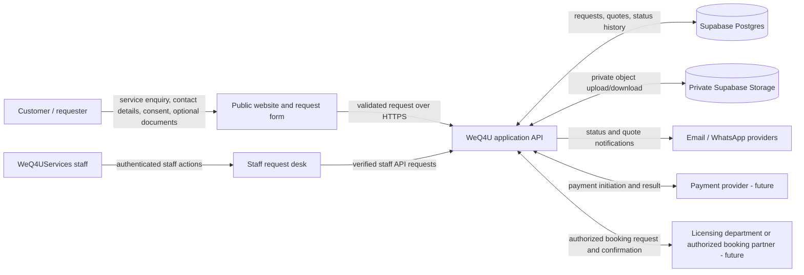
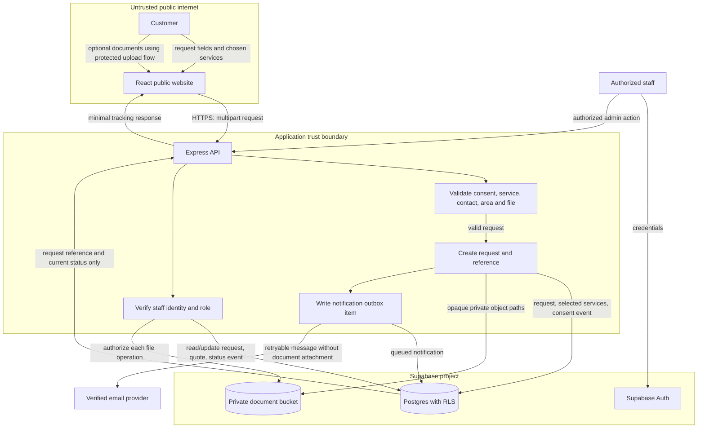
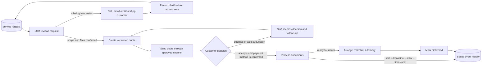
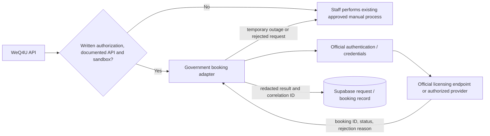
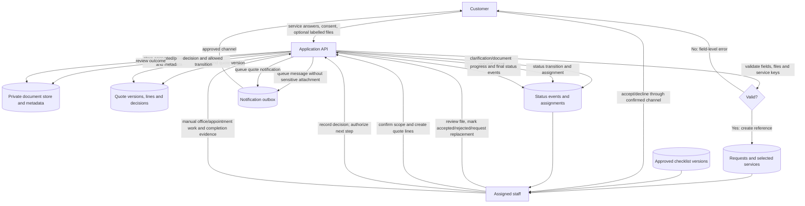

# WeQ4UServices DFD and Workflow Proposal

**Status:** Draft for founder review. These flows describe the intended managed-platform design, not the current local-file prototype.

## 1. DFD Level 0: context

Payment and government connections are future flows. Do not activate them based only on assumptions or public-page behavior.

## 2. DFD Level 1: service request

## 3. DFD Level 1: quote and service processing

This is a manual-assisted business flow until payment, courier and official licensing interfaces are approved and configured.

## 4. DFD Level 2: optional official booking integration

Never screen-scrape, automate staff portals, reuse personal credentials, or send customer documents to an unofficial endpoint without explicit permission and a security/privacy review.

## 5. DFD Level 2: request review, quote and fulfilment

This process is staff-assisted. The customer acceptance channel, payment point, service-specific appointment steps and completion evidence must be confirmed per service before automating transitions.

## 6. Operational workflows to validate with the founder

For each of the eight services, sit with the founder and document:

1. How a request currently arrives and what information is collected first.
2. Which documents are genuinely required, optional, or only requested later.
3. How the founder decides eligibility, area coverage, price and expected timing.
4. Which office/third party is contacted and who performs each action.
5. What happens when documents are missing, a request is rejected, an office is delayed, a quote is declined, or a courier fails.
6. What proof of submission/completion is returned and how long records must be retained.
7. Who can view documents, issue/approve quotes, change statuses, and respond to complaints.

Keep approved customer wording and draft internal procedures separate. Mark every unconfirmed checklist, fee or service promise as draft rather than publishing it.

## 7. Supabase setup order

1. Create separate development and production Supabase projects; add staging if the team will test releases with realistic workflows.
2. Confirm data region and POPIA/data-transfer considerations with the project owner and an appropriate adviser before choosing production location.
3. Create SQL migrations for service catalog, requests, request-services, consent events, private document metadata, status events, staff profiles and audit trail.
4. Seed only the eight founder-approved services. Seed document checklists only after the founder signs off on each one.
5. Enable RLS on every table and test from anonymous, customer-reference and staff contexts. Keep the service-role key server-side only.
6. Create a private storage bucket and policies. Test unauthorized upload/download denial, short-lived access, file-size/type checks, deletion and backup/restore.
7. Replace local JSON/file persistence behind API repository methods; do not let browser code write directly to privileged tables.
8. Migrate only reviewed records, reconcile counts/references, verify attached-file access, then retire local prototype files according to an approved retention plan.

## 8. Acceptance checks for the architecture phase

- Founder confirms the as-is workflow and exception paths for all eight services.
- ERD entities, statuses, quote revision rules, consent notice and staff roles are approved.
- Anonymous browser cannot read requests, private documents, quotes or staff data.
- Staff can only access records and files allowed by role; sensitive changes create audit events.
- A request can be created, quoted, updated, delivered, tracked and deleted/retained according to policy.
- Notification failure does not lose a request; retries are observable and do not duplicate customer actions.
- Backup restoration and migration rollback are rehearsed before any production cutover.
