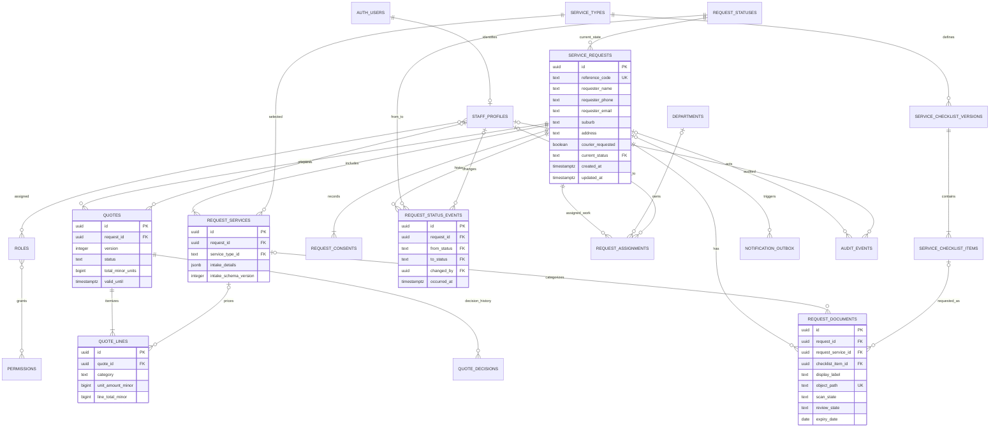

# WeQ4UServices ERD Proposal

**Status:** Draft for founder review. Use alongside the [logical model](logical-model.md) and [PostgreSQL schema draft](postgres-schema-draft.sql). Do not apply as a production schema before process, access and retention decisions are approved.

The expanded target model for workflow instances/tasks, SLA clocks, payment orders/transactions, refunds and retention records is described in the [Digital Service Fulfilment Platform blueprint](../architecture/digital-service-fulfilment-platform.md) and [operations schema extension](platform-operations-schema-draft.sql). Staff interfaces are consolidated in the :3001 Operations & Admin Console.

## Relationship and design notes

- A request may contain multiple selected services. `request_services` stores one row per service, with a JSON intake payload versioned for gradual migration to typed fields.
- A request holds a contact snapshot rather than requiring a customer login/profile in the initial release.
- Document bytes live in private object storage. `request_documents` holds an opaque storage path, classification, scan/review state and optional expiry; a file may be tied to the applicable request service and checklist item.
- Checklist versions are approved and effective-dated. Existing website checklist aids remain draft until the founder approves the requirements for each case.
- Status history, quote decisions, assignments and audit events are separate records, so reports can reconstruct who did what and when.
- A quote is versioned and its lines split handling, authority, third-party, courier and other charges. Store ZAR amounts as integer cents. “Quoted” is not the same as “revenue collected.”
- RBAC uses staff profiles, roles and permissions. Permission checks belong in the API; RLS must also prevent direct anonymous access.
- Payments, receipts/refunds, customer accounts, SLA targets and official external booking records are intentionally later entities. Add them when business rules and providers are confirmed.

## Important approval questions

See [logical model decisions](logical-model.md) and the [founder discovery workshop](founder-discovery-workshop.md). In particular, confirm whether a request may include multiple cases for the same service, quote acceptance evidence, assignment multiplicity, retention/deletion requirements and staff access to sensitive files.
